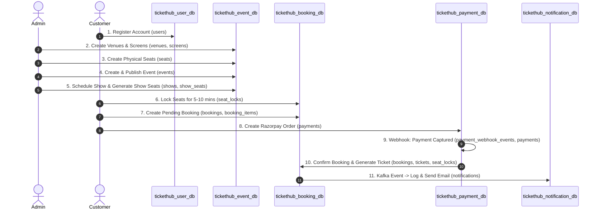

# TicketHub — End-to-End Data Flow & Database Reference Guide

This document explains the exact chronological data flow from start to finish, showing which database and table stores data at each step, along with sample SQL queries to inspect your data.

---

## Architecture Overview (5 Dedicated Microservice Databases)

| Step | Service | Database | Port | Key Tables |
|:---:|---|---|:---:|---|
| **1** | User Service | `tickethub_user_db` | 8082 | `users` |
| **2** | Event Service | `tickethub_event_db` | 8081 | `venues`, `screens`, `seats`, `events`, `shows`, `show_seats` |
| **3** | Booking Service | `tickethub_booking_db` | 8083 | `seat_locks`, `bookings`, `booking_items` |
| **4** | Payment Service | `tickethub_payment_db` | 8084 | `payments`, `payment_webhook_events` |
| **5** | Booking Service | `tickethub_booking_db` | 8083 | `tickets`, `outbox_messages` |
| **6** | Notification Service | `tickethub_notification_db` | 8087 | `notifications` |

---

## Chronological Data Lifecycle (Step-by-Step)



---

### Step 1: User Registration
* **Database**: `tickethub_user_db`
* **Table**: `users`
* **When**: When a user registers via `/api/users/register`.
* **What gets stored**:
  - `user_id` (Primary Key auto-increment)
  - `email` (Unique)
  - `password_hash` (BCrypt encoded)
  - `phone`, `full_name`, `role` (`CUSTOMER` or `ADMIN`)
  - `created_at`, `updated_at`

**Check query**:
```sql
USE tickethub_user_db;
SELECT user_id, email, full_name, role, created_at FROM users;
```

---

### Step 2: Catalog Setup (Admin Master Data)
* **Database**: `tickethub_event_db`
* **Order of Creation**:

1. **`venues`**: Theater or auditorium location (e.g., "PVR Forum Mall", Bangalore).
2. **`screens`**: Auditorium inside the venue (e.g., "Screen 1", linked to `venue_id`).
3. **`seats`**: Master seat layout (e.g., row `A`, seat `A1`, type `PREMIUM`, section `MIDDLE`, base price `300.00`, linked to `screen_id`).
4. **`events`**: Movie, concert, or play details (title, genre, duration, language, status `PUBLISHED`).
5. **`shows`**: Scheduling an event on a screen with date and time (linked to `event_id` and `screen_id`, status `OPEN`).
6. **`show_seats`**: Created for that specific show instance to track availability (`AVAILABLE`, `LOCKED`, or `BOOKED`).

**Check queries**:
```sql
USE tickethub_event_db;
SELECT * FROM venues;
SELECT * FROM screens;
SELECT * FROM seats LIMIT 10;
SELECT event_id, title, status FROM events;
SELECT show_id, event_id, screen_id, show_date, start_time, ticket_price, status FROM shows;
SELECT show_seat_id, show_id, seat_id, price, status FROM show_seats LIMIT 10;
```

---

### Step 3: Seat Locking & Booking Creation
* **Database**: `tickethub_booking_db`
* **When**: Customer selects seats and clicks "Book Now".

1. **`seat_locks`**:
   - Creates a temporary lock on the selected seats for 5–10 minutes so other users cannot pick them.
   - Fields: `show_id`, `seat_id`, `user_id`, `status` (`LOCKED`), `expires_at`.
2. **`bookings`**:
   - Creates a booking record with initial status `PENDING_PAYMENT`.
   - Fields: `id`, `user_id`, `show_id`, `total_amount`, `booking_reference`, `idempotency_key`, `status`.
3. **`booking_items`**:
   - Stores each individual seat linked to this booking (`booking_id`, `seat_id`, `seat_number`, `price`).

**Check queries**:
```sql
USE tickethub_booking_db;
SELECT id, booking_reference, user_id, show_id, total_amount, status, expires_at FROM bookings;
SELECT * FROM booking_items;
SELECT id, show_id, seat_id, user_id, status, expires_at FROM seat_locks;
```

---

### Step 4: Payment Initiation & Webhook Confirmation
* **Database**: `tickethub_payment_db`
* **When**: Customer proceeds to checkout via Razorpay / UPI / Card.

1. **`payments` (Initiation)**:
   - Record created with `booking_id`, `amount`, `currency`, `payment_method`, `razorpay_order_id`, and initial status `PENDING`.
2. **`payment_webhook_events`**:
   - When Razorpay successfully processes the payment, it sends a signed `payment.captured` webhook.
   - The raw payload is stored here for audit and idempotency (`event_id`, `processed=TRUE`).
3. **`payments` (Update)**:
   - Status transitions to `CAPTURED` / `COMPLETED`, recording `razorpay_payment_id` and `razorpay_signature`.

**Check queries**:
```sql
USE tickethub_payment_db;
SELECT id, booking_id, amount, status, razorpay_order_id, razorpay_payment_id FROM payments;
SELECT id, event_id, event_type, processed, received_at FROM payment_webhook_events;
```

---

### Step 5: Booking Confirmation & Ticket Generation
* **Database**: `tickethub_booking_db`
* **When**: Payment Service notifies Booking Service of successful payment.

1. **`bookings` (Update)**:
   - Status changes from `PENDING_PAYMENT` → `CONFIRMED`.
2. **`tickets`**:
   - Permanent ticket generated with `ticket_number` (e.g., `TKT-XXXXXXXX`), `booking_id`, and QR code payload.
3. **`seat_locks` (Update)**:
   - Lock converted from temporary to permanent booking (`status='CONFIRMED'`).
4. **`outbox_messages`**:
   - Transactional Outbox record logged to trigger Kafka event `booking-confirmed`.

**Check queries**:
```sql
USE tickethub_booking_db;
SELECT id, booking_reference, status, updated_at FROM bookings WHERE status = 'CONFIRMED';
SELECT id, booking_id, ticket_number, qr_code, issued_at FROM tickets;
SELECT * FROM outbox_messages;
```

---

### Step 6: Customer Email Notification
* **Database**: `tickethub_notification_db`
* **When**: Notification Service consumes `booking-confirmed` from Kafka and sends email via Mailpit/SMTP.

1. **`notifications`**:
   - Logs the email notification attempt: `booking_id`, `channel='EMAIL'`, `notification_type='BOOKING_CONFIRMATION'`, `recipient`, `status='SENT'`.

**Check query**:
```sql
USE tickethub_notification_db;
SELECT notification_id, booking_id, notification_type, recipient, status, sent_at FROM notifications;
```

---

## Quick All-in-One SQL Verification Script

Run this in your MySQL client to inspect the entire data chain at once:

```sql
SELECT '1. USERS' AS section, COUNT(*) AS count FROM tickethub_user_db.users
UNION ALL
SELECT '2. VENUES', COUNT(*) FROM tickethub_event_db.venues
UNION ALL
SELECT '3. EVENTS', COUNT(*) FROM tickethub_event_db.events
UNION ALL
SELECT '4. SHOWS', COUNT(*) FROM tickethub_event_db.shows
UNION ALL
SELECT '5. BOOKINGS', COUNT(*) FROM tickethub_booking_db.bookings
UNION ALL
SELECT '6. TICKETS', COUNT(*) FROM tickethub_booking_db.tickets
UNION ALL
SELECT '7. PAYMENTS', COUNT(*) FROM tickethub_payment_db.payments
UNION ALL
SELECT '8. NOTIFICATIONS', COUNT(*) FROM tickethub_notification_db.notifications;
```
